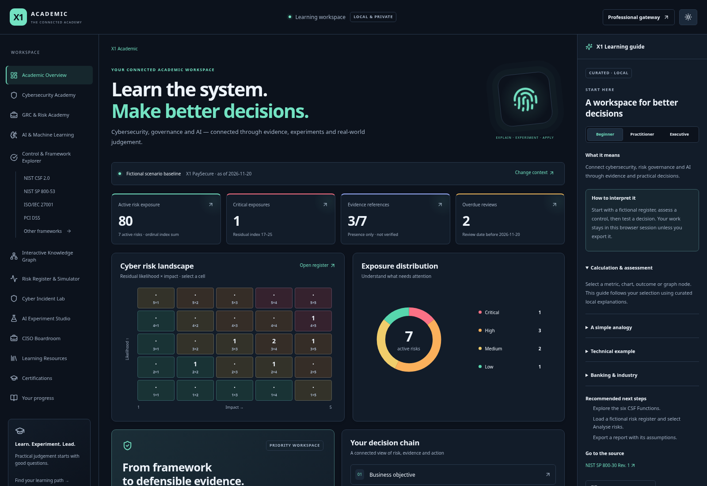
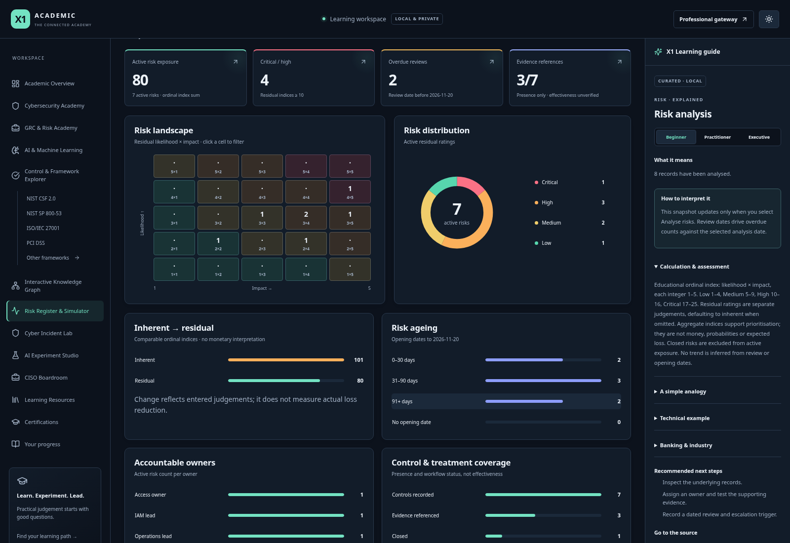
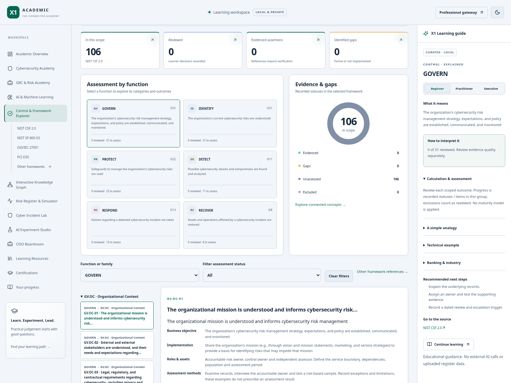
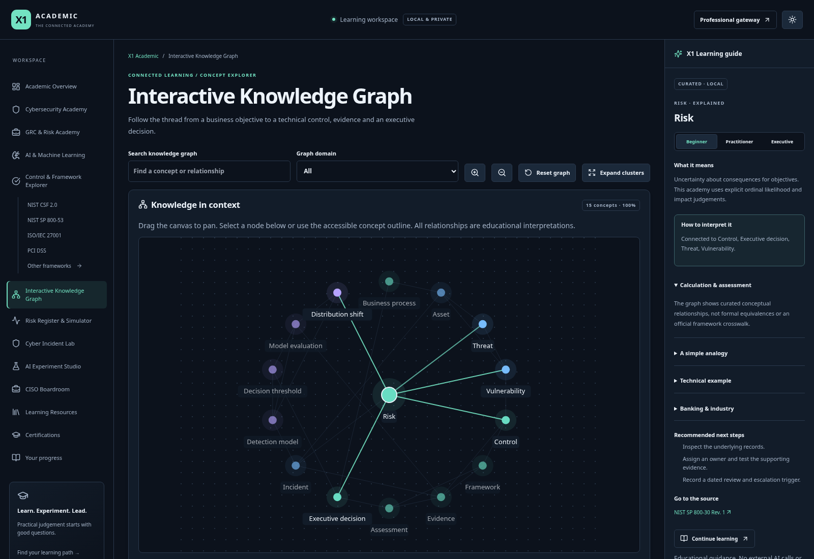
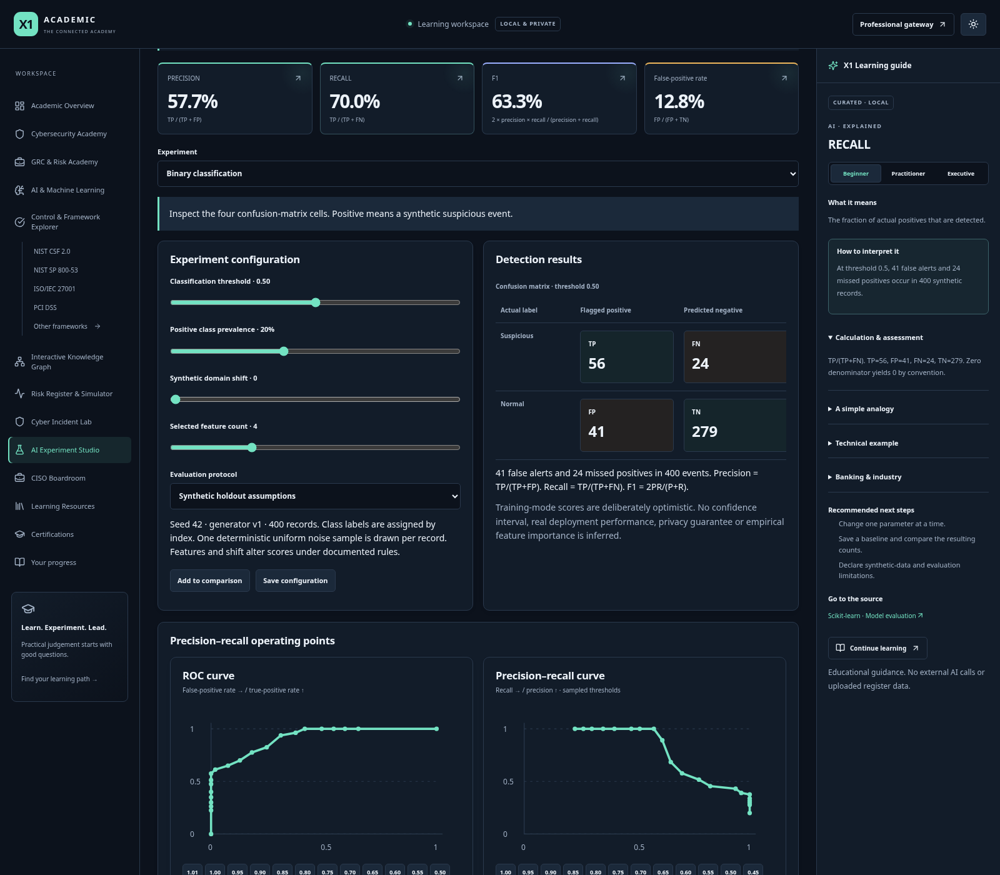
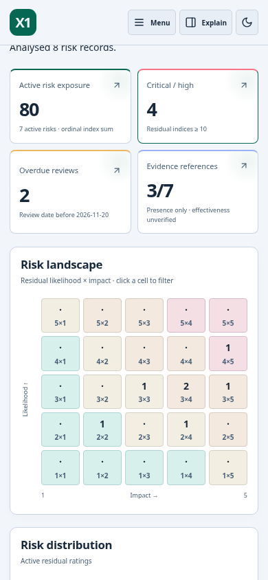

# X1 Academic interactive workspace — implementation report

20 November 2026 · dedicated branch `feat/x1-academy-interactive-workspace` · base `9403047`.

The academy now opens into a working three-panel learning workspace. The original main website, administration, games, personal/professional routes and legacy maps retain their existing route boundaries. All academy capabilities remain below `/x1-academic`.

## Delivered workflows

| Experience | Working behaviour | Scope and interpretation |
| --- | --- | --- |
| Overview & explanation | Live counts from the selected fictional baseline or analysed register; selectable risk matrix, distribution, owner bars, learning links, theme switch and persistent local explanation guide | Explanations are curated locally. Beginner/practitioner/executive views expose definitions, methods and decision relevance. No hosted generative assistant |
| Framework assessment | Six CSF Function cards → 22 Categories → 106 outcomes; official implementation examples; search and family/status filters; owner, evidence, notes and exclusion validation; scoped progress, gap chart, CSV/JSON/print reports; graph links | Full CSF Core. SP 800-53 has 3 base-control summaries, ISO 27001 has 3 clause/theme summaries, PCI DSS has 12 high-level requirement summaries. Other inherited frameworks remain reference entries. No invented maturity/compliance percentages |
| Risk input | Manual add/edit/duplicate/delete, banking/oil-and-gas/manufacturing cases, Excel input template, local `.xlsx`/CSV parsing, column mapping, replace/append and atomic row-level validation/error export | First worksheet; comma CSV; 3 MB, 80 columns, 2000 records. Required ID/asset/threat/L/I; optional residual defaults to inherent. Formula cells rejected |
| Risk analysis | Explicit Analyse snapshot, stale-draft notice, active exposure sum, severity categories, residual matrix, distribution, ageing/overdue reviews, inherent/residual comparison, control/evidence-reference presence, treatment status, owner/unit bars, priority-sorted records and executive summary | Chart selections filter records. Ordinal sum is not money or expected loss. Closed records excluded from active exposure. Reference presence is not evidence verification |
| Risk decisions & reports | Register risk can seed a hypothetical treatment, separate control assumptions/residual ratings, up to four alternatives, deterministic committee topic check; Excel/CSV/JSON, treatment CSV and dedicated printable executive report | Simulator never silently overwrites the register. Reports preserve methodology/provenance/date and the analysed snapshot, independent of filters or pending draft edits |
| Dated observations | Enter a risk/date/rating/source note; reject duplicates; plot same-risk observations with proportional date spacing; inspect underlying records; separate CSV and inclusion in risk JSON/print report | No history is invented. At least two points required. History remains separate from current ratings |
| Knowledge graph | Selectable SVG nodes and keyboard buttons, relationship highlighting, search, domain filters, zoom/pan/reset, expansion using 10 existing security-map concepts, connected workspace links and an accessible concept outline | 15 primary concepts, 25 when expanded; curated relationships, not formal crosswalk equivalence. Mobile presents readable concept buttons and the outline |
| AI studio | Seeded 400-record synthetic evaluation; threshold/prevalence/feature/shift/protocol controls; clickable confusion cells, precision/recall/F1/FPR, ROC/PR operating points, comparisons, raw-prediction CSV and evaluation reports | No model is trained. Generator rules and zero-denominator convention are documented. Sampled curves are not real deployment performance or an AUC claim |
| Incident lab | Synthetic logs, selectable evidence, timeline, service context, hypotheses/severity, evidence-chain feedback, response proposals with evidence-at-decision checks, KPIs and investigation exports | One authored supplier-session narrative with sector context; no real response actions or forensic confidence claim |
| CISO boardroom | Reads analysed register and saved assessments; budget slider, portfolio trade-offs, delivery/dependency bars, roadmap priorities, ownership, assurance/acceptance choices, briefing checks and report exports | Fixed authored capacity/benefit points, parallel-duration assumption, no financial forecast, risk-rating subtraction or fabricated programme history |
| Learning | Existing three complete lessons/exercises/checks, 36-module publication-labelled curriculum, contextual examples, walkthroughs and an expanded 16-resource authoritative catalogue | Remaining 33 modules are planned; the increment does not claim they are authored |

## Data, methodology and security

Risk drafts, snapshots, dated observations and learner assessments persist through internal academy navigation in memory. Changing organisation resets them; browser refresh/close clears unsaved work. Export before refreshing. Only existing anonymous learning progress, bookmarks, theme and explicitly saved AI configuration use localStorage. No risk register or assessment evidence is posted to a service. Browser request monitoring is included in the spreadsheet workflow test.

React text rendering escapes user content. JSON case context remains bounded/schema-checked. CSV exports neutralise formula prefixes; Excel writes literal values, not imported executable formulas. The Excel adapter is lazy-loaded; its approximately 271 KB gzip chunk is fetched only for Excel operations. Its UUID dependency is overridden to a patched CJS-compatible release and exercised by real workbook imports/exports. Large/compressed hostile workbooks remain a browser resource-exhaustion risk; production-scale untrusted-file processing would warrant stronger archive preflight and worker isolation. There is no server-side evidence store, authentication for lab records or multi-user collaboration.

See [source provenance](FRAMEWORK_SOURCES.md), [calculation methods](SIMULATION_METHODOLOGY.md), [security boundaries](SECURITY_REVIEW.md) and [architecture](ARCHITECTURE.md).

## Iterative self-review against the five supplied references

| Perspective | Review and corrections |
| --- | --- |
| UI/UX | Created an original navy/mint workspace, bounded panels, function cards, semantic colours and readable chart legends. Shortened framework source text, corrected tap targets/contrast, kept a third panel at intermediate desktop widths and replaced cramped mobile graph rendering with a concept view |
| GRC Director | Used complete source-derived CSF outcomes, explicit subset scope elsewhere, required evidence/owners/exclusions, corrected combined gap filtering, retained full methodology/provenance in reports and differentiated assertions from independently tested effectiveness |
| CISO | Connected imported register exposure and saved control assessments to the boardroom; separated initiative teaching indices from actual register ratings; showed missing evidence and overdue reviews without inventing historical KPI trends |
| Cybersecurity engineer | Preserved synthetic-event uncertainty, operational approval constraints and evidence-at-decision thresholds; tested exports, validation and local data handling |
| AI scientist | Calculated confusion metrics from deterministic labels/scores, added ROC/PR with selectable operating points and exact tables, exported raw scores, and explicitly marked optimistic training assumptions and the no-positive ROC reference endpoint |
| Technical educator | Added contextual meaning/method/interpretation, analogies, technical/business examples, source links and next steps; kept lesson exercises and knowledge checks; made graph-to-framework-to-simulation navigation work |

These are implementation self-reviews, not independent professional accreditation. Captured screens show the implemented application, not the supplied references or image mockups.

## Verification and deployment

Executed results are recorded in [TEST_REPORT.md](TEST_REPORT.md). The pull request retains the source changes, automated tests, methodologies and these screenshots for review. GitHub Pages continues to use the repository's existing build/deploy workflow; deployment identity is checked through `deployment.json` and published route/asset smoke checks.

## Visual review artifacts

## Remaining work

Full SP 800-53 enhancements/assessment procedures, a licensed complete ISO requirements catalogue, detailed PCI subrequirements, all other framework assessments, 33 planned modules, broader incident narratives, independent evidence validation, a complete dated POA&M lifecycle, real model training, a hosted tutor, authenticated synchronisation and Firefox/WebKit/assistive-technology review remain outside this implementation. Browser print is provided rather than a server-generated signed PDF. There is no claim that this learning platform certifies conformity or replaces an operational GRC system.
